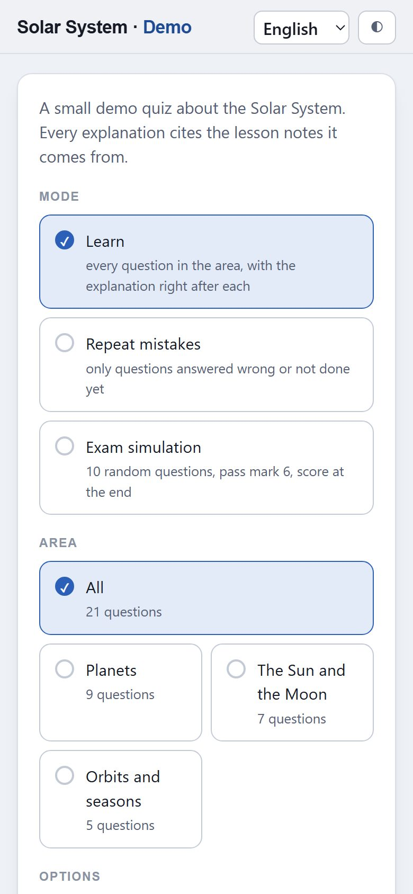
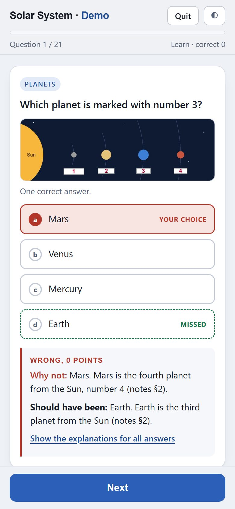
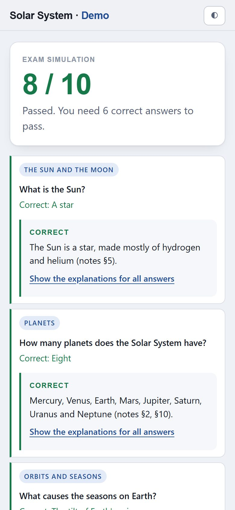

# /buildquiz: study quizzes from course materials, for Claude Code

A Claude Code skill that turns a folder of course materials (lecture slides, old answer keys, scanned or
photographed book pages, Word and PowerPoint files) into a practice quiz you run on your phone. Claude
reads the sources, agrees the scope with you once, writes the questions with an explanation and a source
citation for every option, checks them mechanically and with independent reviewers, and publishes the quiz
as a private Claude artifact (one offline HTML page).

The quiz has three modes: **Learn** (every question, explanation right after each), **Repeat mistakes**
(only questions answered wrong or not yet done), and either an **Exam simulation** (with a pass mark) or a
**Knowledge check** (a score, for school learning). It supports one or more correct answers, pictures cut
from the pages (with labels replaced by numbers), code snippets, an area filter, light and dark themes,
and screens in English, Serbian (Latin or Cyrillic) or Russian, switchable on the start screen; more
languages are one file each. Progress stays on the phone.

  
  
  

The same screens in the [dark theme](docs/screenshots/start-dark.jpg)
([question](docs/screenshots/question-dark.jpg), [results](docs/screenshots/results-dark.jpg)), and the
start screen [switched to Serbian Cyrillic](docs/screenshots/start-sr-Cyrl.jpg). They come from the demo
quiz in [`examples/demo-quiz/`](examples/demo-quiz), a complete worked example of a quiz folder; run
`python docs/screenshots/make.py` to regenerate them.

## Requirements

- Claude Code, with the Artifact tool (to publish the quiz).
- Windows with Microsoft Edge (the render check runs the quiz headless in Edge; HEIC photos are converted
  with the built-in Windows imaging component).
- Python 3.11 or newer with `pdfplumber` and `Pillow`; `pytest` to run the engine tests.

## Install

Clone this repo into your project's skills folder and start a new Claude Code session there:

    cd <your project>
    git clone https://github.com/alexeidjango/buildquiz-skill .claude/skills/buildquiz

Type `/` in Claude Code and check that `buildquiz` is in the list. A skill added during a session appears
only after a restart.

## Operator guide: making a quiz

### 1. Put the sources in one folder

One folder per exam (or per book chapter range), anywhere in the project, e.g. `networks/K2/`:

- lecture slides (PDF or pptx), in subfolders if you like;
- old answer keys (docx, PDF): they decide which questions get asked, never the answers;
- photos of book pages or slides (jpg, png, HEIC straight from the iPhone), scans (PDF without text);
- anything else useful (posters, notes, mock tests).

Material for a different exam may sit in the same folder; you will say what belongs in this quiz.

### 2. Ask for the quiz

    /buildquiz take sources from networks/K2 and build a quiz about everything
    /buildquiz sources in english/test2, only topics "passive voice" and "reported speech"
    /buildquiz biology/book: a quiz for my child (7th grade), lessons 1 and 3

Say which exam it is for, if the folder holds more than one, and for whom the quiz is if it is not you.

### 3. Answer the questions Claude asks

Claude reads everything first (photos and picture-only slides are read page by page, which takes a while
for a big pile). Then:

- **Photographed books only:** you get a list of the lessons and pages found, gaps and duplicates, and you
  choose the topics.
- **The checkpoint (always, once):** a table of the sources and what each is used for, the scope mapped to
  slides or pages, the exam format (number of questions, pass mark; taken from the slides or proposed), or a
  learning quiz without a pass mark, the reader (you, or a child and the grade), the default screen
  language (English, Srpski, Српски, Русский), the questions' language and script, the areas (topic
  groups) and the simulation, and the quiz folder name. Correct anything, then confirm.

After you confirm, Claude runs to the end without stopping: writes the questions (several areas in
parallel), checks them, has every answer verified by an independent reviewer against the sources, builds
the page, plays it headless, and publishes it.

### 4. Get the result

The final message gives the link, the number of questions per area, questions marked "not on the slides"
(asked by an old key but not covered by the slides, answered from general knowledge), unreadable places
in the sources, disagreements between keys and slides, and judgment calls worth a look.

On the iPhone: open the link, then Share → Add to Home Screen. Progress and the chosen screen language are
kept on that device only.

### More quizzes from the same sources

Ask again with a different scope ("only Firewall", "only K2 topics"). Each quiz gets its own folder; the
text already read from the sources (in `<sources>/_text/`) is reused, so nothing is read twice.

### Fixing a question or updating a quiz

Tell Claude what is wrong ("question K014 has the wrong answer, slide 26 says …"). It edits the question
file and republishes with:

    /buildquiz rebuild networks/quiz-k2

A rebuild keeps the same link, so the phone shortcut keeps working. Rebuilds also bring engine
improvements to old quizzes.

### Good to know

- Slides (or the textbook) are the only source of truth for answers. Old keys only supply questions.
- Claude makes no internet searches unless you allow it in that conversation (e.g. to check
  "not on the slides" answers against public documentation).
- A question whose answer can only be checked by running code is not written; you are told instead.
- HEIC photos that Windows cannot convert are reported. The fallback (the `pillow-heif` package) is
  installed only with your permission.
- Each quiz folder holds `quiz.toml` (settings), `bank_<area>.py` (questions), `terms.py` (terms that
  must be covered), optional `items.py` (key and book items that must be covered), `images/` (pictures)
  and the built HTML. `reference/quiz.toml.example` explains every setting.

## Adding a screen language

Screen texts live in `engine/lang/<code>.json`, one file per language, named by its language tag
(`en`, `sr-Latn`, `sr-Cyrl`, `ru`, ...). To add one, e.g. German:

1. Copy `engine/lang/en.json` to `engine/lang/de.json`.
2. Set `name` to the language's own name ("Deutsch") and `letters` to at least 8 option letters.
3. Translate every value in `strings`. Keep `{n}` and `{parts}` placeholders as they are. Plural entries
   (`{"one": ..., "other": ...}`) need one form per plural category of the language, as the browser's
   `Intl.PluralRules` names them (`one`, `few`, `many`, `other`, ...).
4. Run the tests (below). They fail, naming the file and key, if a string is missing or a placeholder or
   plural form is wrong.

Every quiz built afterwards offers the new language in its switcher, and `language = "de"` in
`quiz.toml` makes it a quiz's default.

## How it works

`SKILL.md` is the pipeline Claude follows. `engine/` holds the tools it runs:

| Tool | Does |
|---|---|
| `read_sources.py <sources>` | extracts text into `_text/` (PDF, docx, pptx, txt/md), prepares photos and scans for reading (upright preview + full-resolution halves), converts HEIC; never overwrites a transcription |
| `read_sources.py <sources> --terms` | a first list of coverage terms from **bold** words in transcriptions |
| `pictures.py <quiz> <id> <image> x0 y0 x1 y1 [--mask ...] [--number ...]` | cuts a picture from a page and covers labels with numbers; `--rebuild` rebuilds all pictures |
| `check.py <quiz> [--area X]` | checks the bank: integrity, citations, pictures, script, coverage, simulation size |
| `build.py <quiz>` | builds the single-file quiz from `template.html` and `lang/*.json` |
| `render_check.py <built.html>` | plays every mode and every screen language in headless Edge (with and without storage, no network) |

`reference/` holds the prompts for page transcription, area writers and answer reviewers, the per-quiz
design note template, and the annotated settings example.

Run the engine tests from the skill folder:

    python -m pytest engine/tests -q

A few acceptance tests build the author's own older quizzes (through `engine/tests/legacy.py`) and are
skipped when those folders are absent.

## License

MIT, see `LICENSE`.
